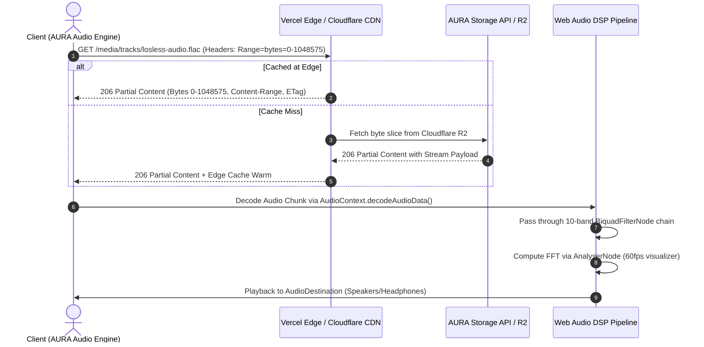
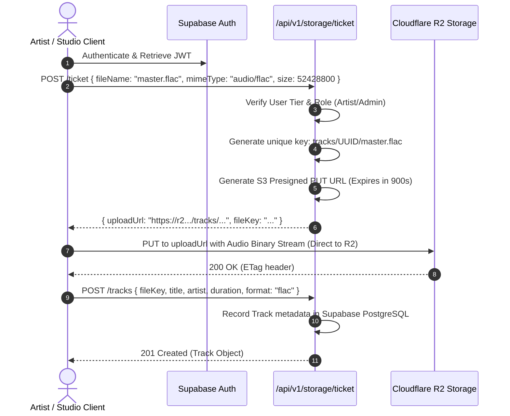
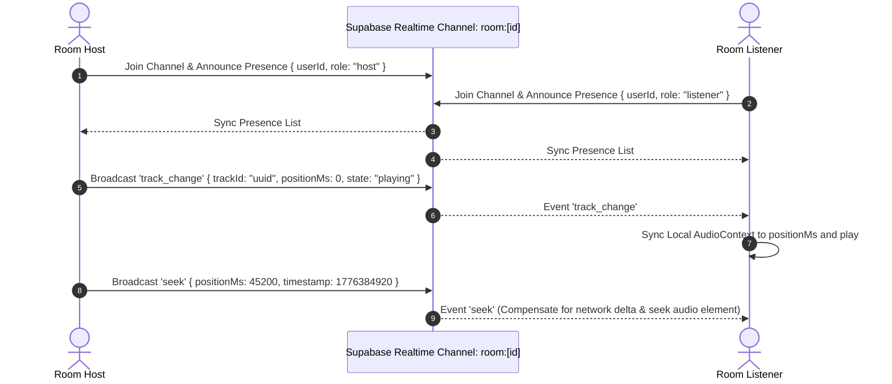

# AURA System Architecture & Engineering Blueprint

This document specifies the end-to-end architecture for **AURA** — a high-fidelity, lossless AI-powered music streaming and acoustic processing platform.

---

## 1. High-Level Architecture Overview

AURA is engineered as a **cross-platform unified hybrid system** providing lossless 24-bit/96kHz audio streaming, real-time DSP acoustic filtering, multi-user listening rooms, and AI-driven music curation across **Web (Next.js & Vercel)**, **Desktop (Tauri v2 for Windows/macOS/Linux)**, and **Mobile (Capacitor 8 for Android/iOS)**.

```mermaid
graph TD
    subgraph Client Surfaces
        WebClient["Web Application (Next.js 14 / Vite SPA)"]
        DesktopClient["Desktop App (Tauri v2 + Rust Core)"]
        MobileClient["Mobile App (Capacitor 8 / Android & iOS)"]
    end

    subgraph CDN & Edge Layer
        VercelEdge["Vercel Global Edge Network (DNS, SSL, Route Handlers)"]
        CloudflareCDN["Cloudflare CDN & R2 Media Distribution (Ranges/Caching)"]
    end

    subgraph Data & Identity Layer (Supabase)
        SupaAuth["Supabase Auth (JWT, OAuth, PKCE, Sessions)"]
        SupaDB["Supabase Postgres (24 Tables, RLS Policies, Indexes)"]
        SupaRealtime["Supabase Realtime (WebSocket Broadcast & Presence)"]
    end

    subgraph Storage & Communication
        R2Bucket["Cloudflare R2 Object Storage (Audio, Covers, Waveforms)"]
        ResendMail["Resend Email Service (Transactional Notifications)"]
    end

    subgraph Backend Microservices
        ExpressAPI["Node.js / Express Audio Engine API"]
        DSPPipeline["Client Web Audio API 10-Band EQ & Visualizer Engine"]
    end

    WebClient --> VercelEdge
    DesktopClient --> ExpressAPI
    MobileClient --> ExpressAPI

    VercelEdge --> SupaDB
    VercelEdge --> SupaAuth

    ExpressAPI --> SupaDB
    ExpressAPI --> SupaAuth
    ExpressAPI --> R2Bucket
    ExpressAPI --> ResendMail

    WebClient --> SupaRealtime
    DesktopClient --> SupaRealtime
    MobileClient --> SupaRealtime

    WebClient --> CloudflareCDN
    DesktopClient --> CloudflareCDN
    MobileClient --> CloudflareCDN

    CloudflareCDN --> R2Bucket
    WebClient --> DSPPipeline
    DesktopClient --> DSPPipeline
    MobileClient --> DSPPipeline
```

---

## 2. Core Pillars & Technology Breakdown

| Subsystem | Technology | Purpose & Responsibility |
| :--- | :--- | :--- |
| **Web Framework & Edge** | **Next.js 14 (App Router) + Vercel** | Serverless Edge Route Handlers, SEO-rich metadata, dynamic client-side hydration, automatic SSL, asset CDN caching. |
| **Native Packaging** | **Tauri v2 + Capacitor 8** | Standalone native builds consuming the optimized Vite bundle (`dist/`) with zero node overhead on client devices. |
| **Database & Identity** | **Supabase (PostgreSQL 15)** | Relational data persistence, Row-Level Security (RLS), ACID transactions, UUID keys, automated `auth.users` synchronization. |
| **Live Collaboration** | **Supabase Realtime** | Serverless sub-millisecond listening room synchronization, collaborative playlists, and peer presence. |
| **Object Storage** | **Cloudflare R2** | Zero-egress-fee distributed storage for FLAC, ALAC, WAV, AAC, MP3, artwork, and precomputed waveform binary arrays. |
| **Email Deliverability** | **Resend** | High-reputation transactional email delivery with DKIM/SPF, branded responsive HTML templates, and webhook event logging. |
| **Acoustic Engine** | **Web Audio API** | 10-band parametric biquad equalizer, 60fps WebGL/Canvas audio visualizers, and spatial acoustic convolutions. |

---

## 3. Data Flow & Sequence Diagrams

### 3.1 Lossless Audio Streaming with HTTP Range Requests & Cloudflare R2



### 3.2 Secure Media Uploading with Presigned S3 URLs

To bypass Vercel serverless 4.5MB request payload constraints and eliminate server bandwidth bottlenecks, uploads stream directly from the client to Cloudflare R2:



### 3.3 Collaborative Social Listening Rooms (Supabase Realtime)



---

## 4. Security & Access Control (RLS & Edge Protection)

1. **Database Isolation:**
   - Every table in PostgreSQL is protected by **Row-Level Security (RLS)**.
   - Non-authenticated reads default to `anon` role (read-only on public tracks, public playlists, and presets).
   - Write/Update operations enforce `auth.uid() = user_id`, guaranteeing cross-tenant data isolation.
2. **Defense-in-Depth Headers:**
   - Strict `Content-Security-Policy` (CSP) preventing XSS.
   - `Strict-Transport-Security: max-age=63072000; includeSubDomains; preload`.
   - `X-Frame-Options: DENY` preventing clickjacking.
   - `X-Content-Type-Options: nosniff`.
3. **Storage Security:**
   - Cloudflare R2 buckets are private by default.
   - Public read access is granted strictly through custom domains or edge-cached CDN proxies with validated MIME types.
   - Direct write access is restricted to S3 presigned URLs with exact content-length and content-type hashes.

---

## 5. Scalability & Resilience Targets

- **Audio Range Latency:** < 50ms initial chunk delivery via Cloudflare Edge PoPs globally.
- **Realtime Sync Jitter:** < 30ms synchronization delta between host and listeners via WebSocket broadcast.
- **Cold Start Elimination:** Next.js static asset optimization with immutable 1-year cache headers (`/assets/*`).
- **Resilient Fallback:** When offline or disconnected from cloud services, client caches local tracks via IndexedDB (`idb-keyval`) and operates fully standalone.
