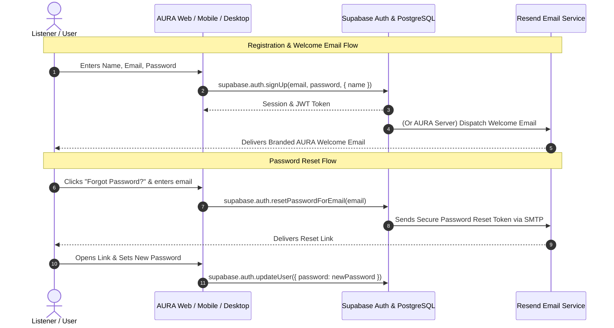

# AURA Authentication & Transactional Email Architecture

**Document Version:** 1.0.0  
**Auth Provider:** Supabase Auth (PKCE, OAuth 2.0, Row Level Security)  
**Email Delivery:** Resend Transactional Email API & Supabase SMTP Gateway  

---

## 1. Architecture Overview

AURA integrates **Supabase Auth** for identity management and **Resend** for transactional email delivery. This eliminates custom cryptography and insecure local password hashing while ensuring verified email deliverability with dark-mode responsive branding.

---

## 2. Supabase Auth Integration with Resend SMTP

To route all Supabase authentication emails (account verification, password recovery, magic links) through Resend with your custom domain:

1. In your **Resend Dashboard** (`https://resend.com/domains`):
   - Add your verified domain (e.g. `aura.audio`).
   - Configure DKIM, SPF, and DMARC DNS records.
   - Generate an SMTP API Key (`re_...`).
2. In your **Supabase Project Settings** (`https://app.supabase.com/project/_/settings/auth`):
   - Navigate to **Auth > Email Templates > SMTP Settings**.
   - Enable **Custom SMTP**.
   - Configure:
     - **Sender Email:** `notifications@aura.audio`
     - **Sender Name:** `AURA Music`
     - **Host:** `smtp.resend.com`
     - **Port:** `465` (SSL)
     - **Username:** `resend`
     - **Password:** `<YOUR_RESEND_API_KEY>`

---

## 3. Transactional Email Workflows

### 3.1 Welcome Email
- **Trigger:** Sent upon new user account creation.
- **Content:** Highlights AURA's core features (Acoustic Lab 10-band EQ, 60fps real-time visualizers, synchronized listening rooms, AI Companion).
- **Service Method:** `emailService.sendWelcomeEmail(toEmail, userName)`.

### 3.2 Password Reset Flow
- **Security Constraint:** AURA never implements custom token generation for password resets. Supabase Auth generates cryptographically signed, short-lived (60 minute) tokens.
- **Service Method:** `emailService.sendPasswordResetEmail(toEmail, resetLink)` for programmatic application notifications or direct Supabase SMTP.

### 3.3 Collaboration & Notification Emails
- **Trigger:** When a user is invited to collaborate on a private playlist or join a VIP listening node.
- **Service Method:** `emailService.sendNotificationEmail(toEmail, subject, heading, bodyHtml, cta)`.

---

## 4. Google OAuth 2.0 Across Platforms

| Platform | Authentication Flow | Redirect / Deep Link Target |
| :--- | :--- | :--- |
| **Web Browser** | Supabase PKCE OAuth Popup / Redirect | `https://aura.audio/auth/callback` |
| **Desktop (Tauri)** | System Browser OAuth + OS Protocol Handler | `aura://oauth/callback` |
| **Mobile (Capacitor)**| Native Google Sign-In SDK (`@capgo/capacitor-google-auth`) | Reads `google-services.json` (Android) / `GoogleService-Info.plist` (iOS) |

---

## 5. Security & Privacy Safeguards

1. **Server-Side API Key:** `RESEND_API_KEY` is strictly confined to server-side code and is never exposed in browser bundles or client requests.
2. **Sanitized Logging:** All email logs sanitize recipient metadata; no password reset tokens or authentication hashes are ever output to logs.
3. **Syntax Validation:** Regex validation ensures emails match standard format before calling downstream APIs, preventing unnecessary charges and bounce penalties.
4. **Resilient Local Fallback:** When running in offline or test environments without an active `RESEND_API_KEY`, the service simulates dispatch with clear console diagnostics without throwing unhandled exceptions.
