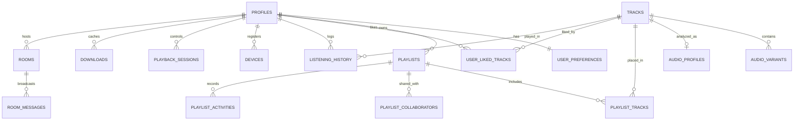

# AURA Database Architecture: PostgreSQL, Supabase & Row Level Security

**Document Version:** 1.0.0  
**Target Engine:** Supabase PostgreSQL 15+ / 16+  
**ORM Support:** Prisma ORM 6.4+ & Supabase Client  

---

## 1. Overview

AURA utilizes **Supabase PostgreSQL** as its primary production relational database and real-time engine. The database manages user identities, audio metadata, lossless audio variants, acoustic profiles, playlists, social listening rooms, listening history, and cross-device playback sessions.

All user-owned data is strictly safeguarded by PostgreSQL **Row Level Security (RLS)** policies. Client applications connect using the public Anon key (`NEXT_PUBLIC_SUPABASE_ANON_KEY`) with scoped JWTs, while server-side administrative jobs utilize the privileged `SUPABASE_SERVICE_ROLE_KEY`.

---

## 2. Entity-Relationship Diagram (ERD)



---

## 3. Migration Files & Execution Order

All migrations reside in `supabase/migrations/` and must be applied sequentially:

| File | Description | Key Objects Created |
| :--- | :--- | :--- |
| `20261017000001_initial_schema.sql` | Core schema definitions | 24 tables, indexes, UUID extensions, `handle_new_user` auth trigger |
| `20261017000002_row_level_security.sql`| Security & isolation | Enables RLS on all 24 tables with granular policies for owners/public/collaborators |
| `20261017000003_realtime_setup.sql` | Supabase Realtime | Publishes `rooms`, `room_messages`, and `playback_sessions` to `supabase_realtime` |
| `supabase/seed.sql` | Seed catalogue & presets | Sample audiophile tracks, 5 system EQ presets, 5 visualizer modes |

---

## 4. How to Apply Migrations

### Method 1: Supabase CLI (Recommended for Local Dev & CI/CD)

1. **Install Supabase CLI:**
   ```bash
   npm install -g supabase
   ```
2. **Link to your remote Supabase project:**
   ```bash
   supabase login
   supabase link --project-ref your-project-id
   ```
3. **Push migrations to remote database:**
   ```bash
   supabase db push
   ```
4. **Seed database:**
   ```bash
   supabase db reset --linked  # Or run supabase/seed.sql via SQL editor
   ```

### Method 2: Supabase Dashboard SQL Editor (Direct Cloud Application)

1. Open your Supabase Project Dashboard: `https://app.supabase.com/project/_/sql`
2. Open `supabase/migrations/20261017000001_initial_schema.sql`, copy all contents, paste into the SQL editor, and click **Run**.
3. Open `supabase/migrations/20261017000002_row_level_security.sql`, paste and click **Run**.
4. Open `supabase/migrations/20261017000003_realtime_setup.sql`, paste and click **Run**.
5. Open `supabase/seed.sql`, paste and click **Run**.

### Method 3: Prisma ORM Integration

To manage the PostgreSQL schema via Prisma:
1. Update `backend/prisma/schema.prisma` datasource:
   ```prisma
   datasource db {
     provider  = "postgresql"
     url       = env("DATABASE_URL")
     directUrl = env("DIRECT_URL")
   }
   ```
2. Run Prisma migration:
   ```bash
   cd backend
   npx prisma db push
   ```

---

## 5. Row Level Security (RLS) Policy Specifications

### User Data Isolation
- **`user_preferences`**: Every operation (`SELECT`, `INSERT`, `UPDATE`) enforces `auth.uid() = user_id`. No user can inspect another user's equalizer or volume preferences.
- **`user_liked_tracks`**: Only the authenticated user can query or toggle likes on their tracks (`auth.uid() = user_id`).
- **`listening_history`**: Analytics telemetry is private to the authenticated listener (`auth.uid() = user_id`).
- **`devices` & `playback_sessions`**: Cross-device state synchronizes only between devices owned by the same user (`auth.uid() = user_id`).

### Collaborative & Public Permissions
- **`playlists`**:
  - `SELECT`: Allowed if `is_public = true` OR `owner_id = auth.uid()` OR user exists in `playlist_collaborators`.
  - `UPDATE`: Allowed for playlist owner OR collaborator with `role IN ('OWNER', 'EDITOR')`.
  - `DELETE`: Strictly restricted to `auth.uid() = owner_id`.
- **`rooms`**:
  - `SELECT`: Public rooms (`is_private = false`) are viewable by all listeners; private rooms are visible only to the room host (`auth.uid() = host_id`).
  - `room_messages`: Insert permitted only for authenticated members inside accessible rooms.

---

## 6. Realtime Subscriptions Architecture

AURA eliminates stateful WebSocket servers by delegating listening rooms and cross-device sync to **Supabase Realtime**:

1. **Room Presence (`presence`):**
   - Monitors connected listeners, latency ping times, and user roles (`host` vs. `listener`).
2. **Playback Synchronization (`broadcast`):**
   - Room hosts broadcast `playback_sync` events containing `currentTime`, `isPlaying`, and `trackId`.
   - Sub-50ms latency between listeners with automatic drift compensation.
3. **Database Change Events (`postgres_changes`):**
   - Subscribes to changes on `public.playback_sessions` for seamless cross-device handover (phone to desktop).

---

## 7. Automated User Provisioning Trigger

Whenever a user registers via Supabase Auth (Email or OAuth), a PostgreSQL trigger (`handle_new_user`) automatically:
1. Inserts a row into `public.profiles` with display name and avatar URL.
2. Inserts a row into `public.user_preferences` with AURA's default audiophile 10-band flat EQ preset and dark theme.
