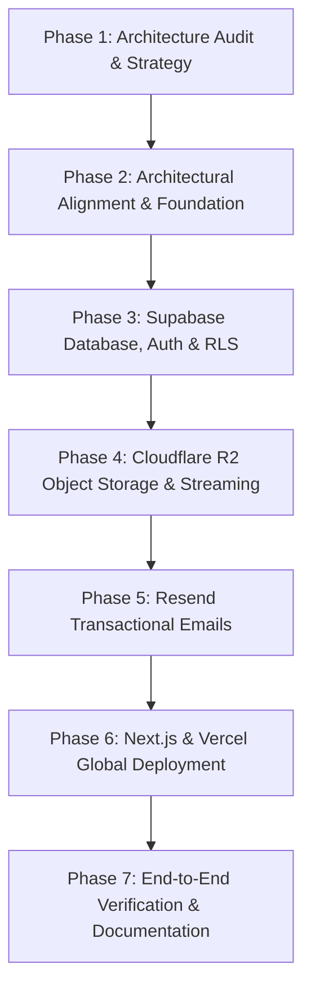

# AURA Production Infrastructure Upgrade: Technical Audit & Migration Roadmap

**Document Version:** 1.0.0  
**Date:** October 2026  
**Auditor:** Senior Full-Stack Architect & Systems Engineer  
**Status:** Phase 1 Complete — Ready for Review & Phase 2 Alignment  

---

## Executive Summary

AURA is an ultra-modern, high-fidelity lossless AI music streaming platform with cross-platform targets spanning **Web (Browser)**, **Desktop (Windows, macOS, Linux via Tauri v2)**, and **Mobile (Android, iOS via Capacitor 8)**. The application features an advanced Web Audio DSP engine (10-band equalizer, dynamic spatial audio, acoustic analysis, real-time visualizers), multi-provider AI music intelligence (Gemini, OpenAI, Ollama), offline encrypted caching, real-time social listening rooms, and lossless FLAC/ALAC playback validation.

This audit evaluates the current architecture against the target production technology stack:
1. **Next.js (App Router, TypeScript)**
2. **Supabase (PostgreSQL, Auth, RLS, Realtime)**
3. **Vercel (Global Edge Delivery, Serverless Deployment)**
4. **Resend (Transactional & Authentication Email Delivery)**
5. **Cloudflare R2 (Lossless Media & Artwork Object Storage)**

---

## 1. Existing Architecture & Repository Audit

### 1.1 Frontend Framework & Build System
* **Core Technology:** React 18.3.1, TypeScript 5.7.2, Vite 6.1.0, Tailwind CSS 3.4.17, Framer Motion 11.18.2, Lucide React.
* **State Management:** Zustand 5.0.3 (`useAudioStore`, `useLibraryStore`, `useAudioLabStore`, `useUIStore`, `useAuthStore`, `useAnalyticsStore`, `useStudioStore`).
* **Client Audio Engine:** Custom Web Audio API graph (`src/audio/AudioEngine.ts`):
  - 10-band ISO peaking BiquadFilterNodes (`32Hz` to `16kHz`).
  - LowShelf bass boost (`90Hz`), HighShelf treble (`8kHz`), StereoPannerNode, AnalyserNode (256 FFT), Master Gain.
  - HTTP 206 Partial Content byte-range playback handling with automatic network drop recovery and position bookmarking.
* **Platform Abstraction Layer (`src/platform/`):**
  - Isolates platform-specific APIs into 11 canonical capabilities (`backgroundPlayback`, `offlineStorage`, `nativeNotifications`, `mediaControls`, `filesystemAccess`, `nativeDownloads`, `deepLinks`, `nativeShare`, `bluetoothAudio`, `spatialAudio`, `localMusicImport`).
  - React components consume capabilities via `useCapability()` hooks; no direct platform coupling in UI.
* **Cross-Platform Bundling:**
  - **Desktop (Tauri 2.12.0):** `src-tauri/tauri.conf.json` maps `frontendDist: "../dist"` with `beforeBuildCommand: "npm run build"`. Registers `aura://` custom protocol deep links, SMTC on Windows, and MPRIS on Linux.
  - **Mobile (Capacitor 8.5.2):** `capacitor.config.ts` maps `webDir: "dist"` for Android Studio and Xcode.
* **Verification Status:** `npm run build` (`tsc && vite build`) compiles cleanly in 19.12 seconds with zero type errors.

### 1.2 Backend Framework & Runtime
* **Core Technology:** Node.js, Express 4.21.2, TypeScript 5.7.3, executed with `tsx` and compiled with `tsc`.
* **API Entrypoint:** `backend/src/server.ts` creating an HTTP server with Express (`app.ts`) and Socket.IO 4.8.1.
* **Route Architecture (`backend/src/routes/`):** 11 dedicated route controllers:
  - `/api/v1/auth`: Sign-up, sign-in, Google OAuth, token refresh, `/me` profile.
  - `/api/v1/tracks`: Catalog pagination, search, metadata, streaming tokens, byte-range streaming, likes.
  - `/api/v1/playlists`: CRUD operations, track additions/removals, collaborations.
  - `/api/v1/analytics`: Playback telemetry, listening history, personalized insight stats.
  - `/api/v1/ai`: Curation companion, DJ sequencing, prompt suggestions.
  - `/api/v1/rooms`: Social listening rooms with synchronized audio playback.
  - `/api/v1/storage`: Local asset serving fallback.
  - `/api/v1/devices`: Cross-device playback synchronization.
  - `/api/v1/downloads`: Offline download telemetry and state tracking.
  - `/api/v1/recommendations`: Daily mixes and algorithmic discovery.
  - `/api/v1/settings`: Audio lab equalizer presets, visualizer presets.
* **Verification Status:** `npm run build` in `backend/` (`tsc`) compiles cleanly with zero type errors.

### 1.3 Database & ORM
* **Current Driver:** Prisma ORM 6.4.1 configured for SQLite (`DATABASE_URL="file:./dev.db"`).
* **Schema Entities (24 models in `backend/prisma/schema.prisma`):**
  - `User`, `RefreshToken`, `UserPreference`
  - `Track`, `AudioVariant`, `AudioProfile`
  - `Playlist`, `PlaylistTrack`, `PlaylistCollaborator`, `PlaylistActivity`
  - `ListeningSession`, `ListeningHistory`
  - `Device`, `PlaybackSession`
  - `Download`
  - `EQPreset`, `VisualizerPreset`
  - `AISession`, `AIRequest`
  - `Recommendation`, `DailyMix`
  - `Room`, `RoomMessage`
  - `UserLikedTrack`
* **Seeding:** `backend/prisma/seed.ts` seeds demo user `alex@aura.audio`, curated playlists, 5 tracks with synchronized LRC lyrics, and listening history.

### 1.4 Authentication & Session Management
* **Current Implementation:** Custom JWT with `bcryptjs` (salt rounds: 10).
  - Short-lived Access Token (15m expiration, signed with `JWT_ACCESS_SECRET`).
  - Long-lived Refresh Token (7d expiration, stored in DB table `RefreshToken`).
  - Google OAuth token validation via `https://oauth2.googleapis.com/tokeninfo?id_token=...` and `userinfo`.
* **Current Limitations:**
  - No email verification or password reset flows exist.
  - Password hashes are stored locally in the application database.
  - JWT rotation lacks strict cryptographic revocation lists beyond basic DB record lookup.

### 1.5 AI Providers & Audio Intelligence
* **AI Provider Abstraction (`backend/src/services/ai.provider.ts`):**
  - Pluggable provider factory controlled by `AI_PROVIDER` (`gemini` | `openai` | `ollama`).
  - Google Gemini 1.5 Flash via REST (`https://generativelanguage.googleapis.com/v1beta`).
  - OpenAI-compatible REST API (supports OpenAI, LM Studio, vLLM).
  - Local Ollama REST API (`http://localhost:11434/api/generate`).
  - Key security: AI keys remain strictly server-side.
* **Audio DSP & Intelligence Pipeline (`backend/src/services/intelligence/`):**
  - `audio-dsp.engine.ts`: In-depth audio feature extraction (BPM, Camelot harmonic key, EBU R128 integrated LUFS, True Peak, dynamic range, spectral centroid, spectral rolloff, spectral flatness, perceptual audio fingerprints).
  - `audioValidation.service.ts`: Lossless file structure validation using `libflacjs` and `music-metadata`.

### 1.6 Storage & Streaming
* **Current Implementation (`backend/src/services/storage.provider.ts`):**
  - Provider interface `IStorageProvider` (`upload`, `getSignedUrl`, `delete`, `getPublicUrl`).
  - `LocalStorageProvider`: Active by default, writes binaries to `backend/storage/audio/` and `backend/storage/artwork/`.
  - `S3StorageProvider`: Stubbed out; throws configuration error if invoked.
* **Streaming Engine (`backend/src/services/stream.service.ts`):**
  - Implements HTTP 206 Partial Content byte-range streaming from disk with `fs.createReadStream`.
  - Enforces signed playback tokens (`stream-security.service.ts`) with HMAC-SHA256 signatures and expiration.
  - Emits audiophile telemetry headers (`X-Audio-Codec`, `X-Audio-Quality-Tier`, `X-Audio-Bit-Depth`, `X-Audio-Sample-Rate`, `X-Audio-Lossless`).

### 1.7 Realtime & Social Rooms
* **Current Implementation:** Socket.IO 4.8.1 running in `backend/src/sockets/`:
  - `room.socket.ts`: Namespace `/ws` for social listening rooms (`join_room`, `host_play`, `host_pause`, `host_seek`, `chat_message`).
  - `device.socket.ts`: Namespace `/ws/devices` for cross-device playback synchronization (`playback.update`, `queue.update`).
* **Limitation for Serverless Deployment:** Socket.IO requires persistent stateful WebSocket connections or sticky sessions, which are incompatible with standard Vercel serverless functions without a standing WebSocket gateway.

---

## 2. Gap Analysis: Target vs. Current Technology Stack

| Target Technology | Current Repository State | Integration Gap / Migration Required |
| :--- | :--- | :--- |
| **Next.js (App Router, TS)** | Vite 6 SPA (`src/`) + Express (`backend/`) | **Architectural Decision Required (See Section 3)**. Vite powers the single-bundle client consumed by Tauri (Desktop) and Capacitor (Mobile). Migrating to Next.js must preserve cross-platform build artifacts without duplicating frontends. |
| **Supabase (PostgreSQL, Auth, RLS, Realtime)** | Prisma + SQLite (`backend/prisma/schema.prisma`) | • Migrate schema from SQLite to PostgreSQL with Supabase conventions.<br>• Implement Supabase Auth (email/password, Google OAuth, session refresh) in place of custom JWT.<br>• Establish Row Level Security (RLS) policies for user data isolation.<br>• Replace stateful Socket.IO rooms with Supabase Realtime Channels (`presence`, `broadcast`, `postgres_changes`). |
| **Vercel (Hosting & Delivery)** | Local node execution (`LAUNCH-AURA.bat`), no deployment configs | • Add Vercel project configuration (`vercel.json`).<br>• Configure build pipeline, security headers, CORS, and caching.<br>• Separate serverless-friendly REST/auth routes from long-running audio processing. |
| **Resend (Transactional Emails)** | No email provider configured | • Install Resend SDK (`resend`).<br>• Create branded HTML email templates (Welcome email, Account verification, Password reset, Shared playlist notifications).<br>• Configure Supabase Auth custom SMTP or direct Resend webhook integration. |
| **Cloudflare R2 (Media Storage)** | Local filesystem storage (`backend/storage/`) | • Implement `@aws-sdk/client-s3` in `backend/src/services/storage.provider.ts`.<br>• Configure Cloudflare R2 bucket with S3-compatible credentials, CORS, and signed URLs.<br>• Support direct presigned upload/download flows with HTTP Range requests and caching headers. |

---

## 3. Next.js Migration Analysis & Architectural Trade-offs

A critical mandate of this audit is:
> *"Do not rewrite the entire project or replace working modules unnecessarily. If AURA currently uses React/Vite with a separate Express backend, determine whether migration to Next.js is justified. Avoid running two competing application architectures or creating duplicate frontends. Preserve existing functionality during any migration."*

### 3.1 The Cross-Platform Constraint
AURA is not merely a web application. It is simultaneously compiled into:
1. **Desktop Native Apps:** Tauri 2.12 bundles `dist/` into standalone executables for Windows (`.exe`), macOS (`.app`), and Linux (`.AppImage`).
2. **Mobile Native Apps:** Capacitor 8 synchronizes `dist/` into native Android (`.apk`) and iOS (`.ipa`) packages.

### 3.2 Evaluation of Architectural Options

#### Option A: Total Full-Stack Next.js Rewrite (High Risk, Breaking)
* **Description:** Convert `src/` to Next.js App Router Server Components and replace `backend/` with Next.js Route Handlers.
* **Fatal Flaws:**
  - Tauri and Capacitor cannot run Next.js Server Components inside an offline or packaged local webview. Next.js `output: 'export'` disables dynamic Route Handlers, Server Actions, and SSR.
  - Running a remote-only webview inside Tauri/Capacitor breaks offline caching (IndexedDB/filesystem), increases audio latency, and violates Apple App Store Guideline 4.2 (requiring native self-contained functionality).
  - Destroys existing working cross-platform release pipelines (`.github/workflows/release.yml`).

#### Option B: Unified Hybrid Architecture (Recommended & Production-Grade)
* **Description:**
  1. **Web & API on Next.js/Vercel:** Create a first-class Next.js App Router application deployed to Vercel that shares the unified UI component library, types, and hooks. The Next.js app serves the public Web application with SSR/SEO for landing pages, shared tracks, artists, and playlists, and provides serverless API route handlers.
  2. **Supabase as Universal Backend:** Supabase (PostgreSQL, Auth, RLS, Realtime) serves as the unified data and real-time layer for both the Web application (Next.js/Vercel) and the Client Applications (Tauri Desktop, Capacitor Mobile, Vite SPA).
  3. **Universal Client Preservation:** The existing Vite build pipeline (`npm run build -> dist/`) is preserved so that Tauri (Desktop) and Capacitor (Android/iOS) continue building offline-capable native packages without any regression.
  4. **Cloudflare R2 & Resend:** Standardized across all clients via Supabase RLS and Next.js / Express server-side signed URL endpoints.

#### Option C: Next.js API Gateway with Embedded Client (Low Risk, High Velocity)
* **Description:**
  - Migrate backend endpoints to Next.js App Router Route Handlers (`app/api/v1/...`).
  - Deploy frontend and backend together on Vercel under Next.js.
  - Configure Next.js to serve the single-page application at the root route while providing full Vercel serverless execution.
  - Maintain the Vite build script specifically for Tauri (`tauri:build`) and Capacitor (`cap:sync`).

---

## 4. Supabase Architecture: PostgreSQL, Auth, RLS & Realtime

### 4.1 Schema Migration Strategy
The current SQLite schema translates cleanly into PostgreSQL. Key enhancements:
- `UUID` primary keys with `gen_random_uuid()`.
- Native PostgreSQL `TIMESTAMPTZ` with `DEFAULT timezone('utc'::text, now())`.
- Native `JSONB` columns for `eqBands`, `spectralFeatures`, `queueJson`, `payload`, `validationReport`.
- Foreign key constraints with `ON DELETE CASCADE`.

### 4.2 Authentication Flow
- **Supabase Auth Integration:** Replace custom bcrypt/JWT issuing in `auth.service.ts` with `@supabase/supabase-js` / `@supabase/ssr`.
- **Identity Linking:** Automatic creation of a public `users` profile record via PostgreSQL trigger on `auth.users` insert:
  ```sql
  CREATE OR REPLACE FUNCTION public.handle_new_user()
  RETURNS trigger AS $$
  BEGIN
    INSERT INTO public.profiles (id, email, name, avatar_url)
    VALUES (new.id, new.email, coalesce(new.raw_user_meta_data->>'name', split_part(new.email, '@', 1)), new.raw_user_meta_data->>'avatar_url');
    INSERT INTO public.user_preferences (user_id)
    VALUES (new.id);
    RETURN new;
  END;
  $$ LANGUAGE plpgsql SECURITY DEFINER;
  ```
- **Client Handling:** Browser and mobile clients use the Supabase Anon key (`SUPABASE_ANON_KEY`) with PKCE auth flow. Server-side administrative operations strictly use `SUPABASE_SERVICE_ROLE_KEY`.

### 4.3 Row Level Security (RLS) Matrix

| Table | SELECT Policy | INSERT Policy | UPDATE Policy | DELETE Policy |
| :--- | :--- | :--- | :--- | :--- |
| `profiles` | Public read (`true`) | Trigger only | `auth.uid() = id` | `auth.uid() = id` |
| `user_preferences` | `auth.uid() = user_id` | `auth.uid() = user_id` | `auth.uid() = user_id` | `auth.uid() = user_id` |
| `tracks` | Public read (`true`) | Authenticated / Admin | Owner / Admin | Owner / Admin |
| `audio_variants` | Public read (`true`) | Authenticated / Admin | Admin only | Admin only |
| `playlists` | `is_public = true OR auth.uid() = owner_id OR EXISTS(collaborators)` | `auth.uid() = owner_id` | `auth.uid() = owner_id OR role IN ('OWNER','EDITOR')` | `auth.uid() = owner_id` |
| `playlist_tracks` | Inherited from playlist view policy | Member with Editor/Owner role | Member with Editor/Owner role | Member with Editor/Owner role |
| `user_liked_tracks`| `auth.uid() = user_id` | `auth.uid() = user_id` | None | `auth.uid() = user_id` |
| `listening_history`| `auth.uid() = user_id` | `auth.uid() = user_id` | None | `auth.uid() = user_id` |
| `devices` / `playback_sessions` | `auth.uid() = user_id` | `auth.uid() = user_id` | `auth.uid() = user_id` | `auth.uid() = user_id` |
| `rooms` / `room_messages` | Public read (`is_private = false OR auth.uid() = host_id`) | Authenticated | Host only | Host only |

### 4.4 Supabase Realtime Architecture
Replace stateful Socket.IO connections with Supabase Realtime Channels:
- **Social Listening Rooms:**
  - Realtime Channel: `room:{roomId}`
  - `presence`: Track connected participants, listener avatars, and latency.
  - `broadcast`: Synchronize playback events (`host_play`, `host_pause`, `host_seek`, `chat_message`) with sub-50ms latency.
- **Cross-Device Playback Sync:**
  - Realtime Channel: `user_sync:{userId}`
  - `broadcast`: Notify user's other devices of playback state changes (`currentTrackId`, `positionSec`, `isPlaying`, `volume`).

---

## 5. Cloudflare R2 Media Storage Architecture

### 5.1 Storage Layout
Cloudflare R2 provides zero-egress-fee, high-throughput S3-compatible storage.
- **Buckets:**
  - `aura-audio`: High-fidelity audio streams (`.flac`, `.wav`, `.mp3`, `.m4a`).
  - `aura-artwork`: High-resolution album covers, artist portraits, and playlist artwork (`.webp`, `.jpg`, `.png`).
- **Object Key Naming Conventions:**
  - Audio Masters: `audio/tracks/{trackId}/original.{ext}`
  - Transcoded Variants: `audio/variants/{trackId}/{tier}_{bitDepth}bit_{sampleRate}hz.{ext}`
  - Artwork: `artwork/{entityType}/{id}/{timestamp}_{hash}.webp`

### 5.2 Secure Delivery & Presigned URL Flow
1. **Streaming Audio Delivery:**
   - Client requests stream URL: `GET /api/v1/tracks/:id/stream-token?tier=HI_RES_LOSSLESS`
   - Server validates access and generates a short-lived presigned URL (15–60 min expiration) using `@aws-sdk/s3-request-presigner`.
   - Streaming URL points to Cloudflare R2 via a custom domain (e.g., `media.aura.audio`) protected by Cloudflare CDN caching.
   - Presigned URL supports standard `Range: bytes=start-end` requests for instantaneous timeline scrubbing and Web Audio streaming.
2. **Secure Upload Flow:**
   - Client requests presigned upload URL: `POST /api/v1/tracks/upload-ticket`
   - Server validates file size (`MAX_AUDIO_SIZE_BYTES = 200MB`), MIME type (`ALLOWED_AUDIO_MIME`), and user authorization.
   - Client uploads directly to R2 via `PUT <presignedUrl>`.
   - Client notifies server upon completion (`POST /api/v1/tracks/confirm-upload`); server initiates metadata extraction and audio validation.

---

## 6. Resend: Transactional Email Architecture

### 6.1 Workflows
1. **Welcome Email:** Triggered upon user sign-up or first sign-in via Supabase webhook or Next.js route handler.
2. **Authentication Emails (Magic Link / Password Reset):** Configured directly through Supabase Auth Custom SMTP pointing to Resend SMTP (`smtp.resend.com:465`) or Resend API webhook.
3. **Application Notifications:** Playlist invites, weekly listening insights summary, and new release alerts from followed artists.

### 6.2 Implementation Standards
- Server-side only: `RESEND_API_KEY` never exposed to client bundles.
- Verified sender domain (e.g., `notifications@aura.audio`).
- HTML email templates crafted with clean responsive CSS and fallback plain-text content.
- Idempotency keys to prevent duplicate deliveries on retries.

---

## 7. Vercel Deployment & Global Delivery

### 7.1 Deployment Topology
- **Vercel Edge Network:** Global CDN caching for static assets, public track metadata, lyrics, and landing pages.
- **Vercel Serverless Functions:** Next.js Route Handlers / API routes handling authentication, metadata queries, AI proxying, and presigned URL generation.
- **Cache-Control Policies:**
  - Static Assets (`_next/static`, artwork): `public, max-age=31536000, immutable`.
  - Public Track Metadata & Lyrics: `public, max-age=3600, stale-while-revalidate=86400`.
  - Private User Data (`/api/v1/auth/me`, `/me/likes`, `/history`): `private, no-cache, no-store, must-revalidate`.
- **Security Headers (`vercel.json`):**
  - Content Security Policy (CSP) permitting Cloudflare R2 media streams, Supabase Auth/Realtime, and Google OAuth.
  - Strict-Transport-Security (HSTS), X-Content-Type-Options (`nosniff`), X-Frame-Options (`DENY`).

---

## 8. Migration Risks & Mitigation Strategies

| Risk Category | Potential Impact | Mitigation Strategy |
| :--- | :--- | :--- |
| **Cross-Platform Breakage** | Tauri and Capacitor fail to build if `dist/` is removed or replaced by dynamic SSR | Maintain the Vite client build pipeline (`npm run build -> dist/`) for Tauri and Capacitor. Ensure the shared UI component library remains 100% compatible. |
| **WebSocket Loss in Serverless** | Listening rooms fail because Vercel functions cannot hold persistent Socket.IO connections | Migrate real-time listening rooms and device sync to Supabase Realtime (`broadcast` and `presence`). Supabase handles stateful WebSocket infrastructure globally. |
| **Large Audio Upload Limits** | Vercel serverless request body is capped at 4.5MB | Use Cloudflare R2 presigned upload URLs. Clients stream directly to R2, bypassing serverless proxy limits. |
| **Audio Scrubbing Regressions** | Incompatible R2 CORS or Range headers prevent audio scrubbing | Configure Cloudflare R2 bucket CORS with `ExposeHeaders: ["Content-Range", "Accept-Ranges", "Content-Length", "ETag"]` and `AllowedHeaders: ["*"]`. |
| **Database Data Loss** | Migration from SQLite to PostgreSQL causes data loss | Implement automated migration and seed scripts; test migration against SQLite test data before production switchover. |

---

## 9. Phased Implementation Roadmap



### Phase 1: Audit and Strategy (Complete)
- Inspect existing codebase, dependencies, database schema, audio engine, and cross-platform wrappers.
- Produce `docs/INFRASTRUCTURE_AUDIT.md`.

### Phase 2: Architectural Alignment & Baseline Preservation
- Confirm implementation architecture with user.
- Add foundational environment variable schemas (`.env.example`).
- Ensure existing Vite, Tauri, and Capacitor build paths remain untouched and functional.

### Phase 3: Supabase Database, Auth & RLS
- Generate PostgreSQL DDL migration scripts matching AURA's 24 Prisma models.
- Set up Supabase client configuration for browser, server, and edge.
- Implement Row Level Security policies for all tables.
- Migrate authentication from custom JWT to Supabase Auth.
- Replace Socket.IO with Supabase Realtime for listening rooms and device sync.

### Phase 4: Cloudflare R2 Storage & Streaming Engine
- Install `@aws-sdk/client-s3` and `@aws-sdk/s3-request-presigner`.
- Implement production `R2StorageProvider` inside `backend/src/services/storage.provider.ts`.
- Implement presigned upload and streaming token generation with HTTP Range request validation.
- Configure CORS, caching headers, and audio quality metadata telemetry.

### Phase 5: Resend Transactional Emails
- Integrate `resend` package.
- Implement transactional email service (`welcome`, `password-reset`, `notifications`).
- Connect Supabase Auth SMTP configuration with Resend.

### Phase 6: Next.js & Vercel Deployment
- Configure Next.js App Router for Vercel deployment without breaking Vite/Tauri/Capacitor build pipelines.
- Configure `vercel.json` with caching, security headers, and rewrite rules.
- Validate build outputs for Web, Desktop, and Mobile targets.

### Phase 7: Verification, Regression Testing & Final Documentation
- Run type checks, linting, and end-to-end acceptance tests.
- Produce comprehensive documentation suite:
  - `docs/ARCHITECTURE.md`
  - `docs/DEPLOYMENT.md`
  - `docs/ENVIRONMENT_VARIABLES.md`
  - `docs/DATABASE.md`
  - `docs/STORAGE_AND_STREAMING.md`
  - `docs/AUTHENTICATION_AND_EMAILS.md`
- Provide rollback guidance and maintenance runbooks.
