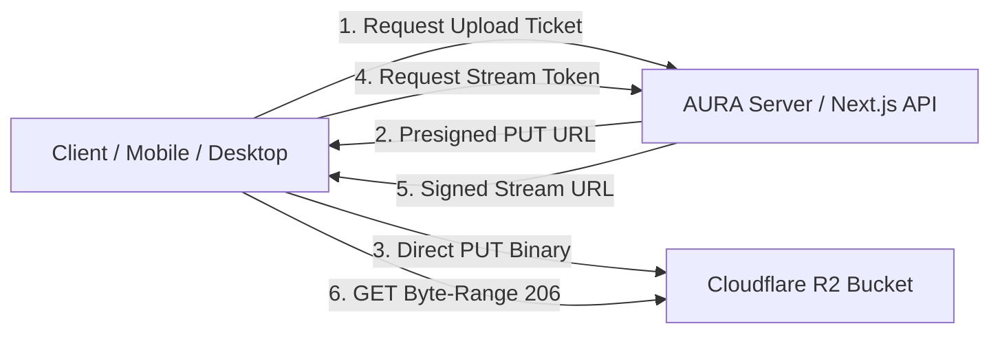

# AURA Media Storage & High-Fidelity Audio Streaming

**Document Version:** 1.0.0  
**Storage Provider:** Cloudflare R2 (S3-Compatible) & Local Filesystem Fallback  
**Streaming Protocol:** HTTP 206 Partial Content (Byte-Range Scrubbing)  

---

## 1. Overview

AURA stores all audio binaries (FLAC, ALAC, WAV, MP3, AAC) and high-resolution artwork (album covers, artist avatars) in **Cloudflare R2 Object Storage**. Rather than storing bulky binaries in PostgreSQL, Supabase stores lightweight metadata, ownership records, and object keys, while Cloudflare R2 delivers zero-egress audio streaming globally at ultra-low latency.

---

## 2. Storage Topology & Buckets



### Bucket Configuration
| Bucket | Content Type | Max Size | Cache-Control Policy |
| :--- | :--- | :--- | :--- |
| `aura-audio` | Audio masters (`audio/flac`, `audio/wav`, `audio/mpeg`, etc.) | 200 MB | `public, max-age=86400, stale-while-revalidate=604800` |
| `aura-artwork` | Album & artist images (`image/webp`, `image/jpeg`, `image/png`) | 20 MB | `public, max-age=31536000, immutable` |

---

## 3. Upload Architecture: Direct-to-R2 Presigned URLs

Serverless platforms like Vercel have a strict request body size limit of **4.5 MB**. Because high-resolution 24-bit/96kHz FLAC files frequently exceed 50–150 MB, AURA uses **Presigned Upload Tickets**:

1. **Ticket Request:**
   Client calls `POST /api/v1/storage/ticket`:
   ```json
   {
     "bucket": "audio",
     "filename": "symphony-master.flac",
     "mimeType": "audio/flac"
   }
   ```
2. **Server Authorization & Ticket Issuance:**
   The server validates user authentication, validates MIME type against `ALLOWED_AUDIO_MIME`, generates a UUID-based key, and signs a short-lived PUT URL (`@aws-sdk/s3-request-presigner`) expiring in 15 minutes:
   ```json
   {
     "success": true,
     "data": {
       "uploadUrl": "https://<ACCOUNT_ID>.r2.cloudflarestorage.com/aura-audio/f1c95847...flac?X-Amz-Signature=...",
       "objectKey": "f1c95847-b07c-4839-b7dd-60a7dc74eb61.flac",
       "bucket": "audio",
       "publicUrl": "https://media.aura.audio/aura-audio/f1c95847...flac",
       "expiresInSeconds": 900
     }
   }
   ```
3. **Direct Client Upload:**
   The browser or mobile app uploads the file directly to Cloudflare R2 via standard HTTP `PUT`:
   ```http
   PUT <uploadUrl>
   Content-Type: audio/flac
   Body: <binary payload>
   ```

---

## 4. Audio Streaming & HTTP 206 Byte-Range Scrubbing

AURA's custom Web Audio engine ([`AudioEngine.ts`](file:///c:/Users/benos/Desktop/AURA/src/audio/AudioEngine.ts)) requires instant scrubbing across large lossless files without waiting for the full file to download:

### 1. Client Scrub Request
When seeking to minute 2:30, the client issues a partial byte request:
```http
GET /api/v1/tracks/track-1/stream?tier=HI_RES_LOSSLESS HTTP/1.1
Range: bytes=10485760-20971520
If-Range: "W/38841920-1729000000"
```

### 2. Server & R2 Partial Content Response
The server responds with HTTP **206 Partial Content**:
```http
HTTP/1.1 206 Partial Content
Content-Range: bytes 10485760-20971520/38841920
Accept-Ranges: bytes
Content-Length: 10485761
Content-Type: audio/flac
ETag: "W/38841920-1729000000"
Cache-Control: public, max-age=86400, stale-while-revalidate=604800
X-Audio-Codec: FLAC
X-Audio-Quality-Tier: HI_RES_LOSSLESS
X-Audio-Bit-Depth: 24
X-Audio-Sample-Rate: 96000
X-Audio-Channels: 2
X-Audio-Lossless: true
```

---

## 5. Cloudflare R2 Bucket CORS Setup

To permit direct browser streaming and Web Audio API analyser access, configure your Cloudflare R2 bucket CORS:

```json
[
  {
    "AllowedOrigins": [
      "https://aura.audio",
      "https://*.vercel.app",
      "http://localhost:3000",
      "tauri://localhost",
      "capacitor://localhost"
    ],
    "AllowedMethods": [
      "GET",
      "HEAD",
      "PUT"
    ],
    "AllowedHeaders": [
      "*"
    ],
    "ExposeHeaders": [
      "Content-Range",
      "Accept-Ranges",
      "Content-Length",
      "ETag",
      "X-Audio-Codec",
      "X-Audio-Quality-Tier",
      "X-Audio-Bit-Depth",
      "X-Audio-Sample-Rate",
      "X-Audio-Lossless"
    ],
    "MaxAgeSeconds": 86400
  }
]
```

---

## 6. Development vs. Production Fallback

AURA is engineered with zero-breakage resilience:
- **Production (`STORAGE_PROVIDER=r2`):** Reads and writes through `R2StorageProvider` using `@aws-sdk/client-s3`.
- **Development / Missing Credentials:** Automatically detects missing keys and smoothly defaults to `LocalStorageProvider`, storing files safely in `backend/storage/audio/` and `backend/storage/artwork/`.
